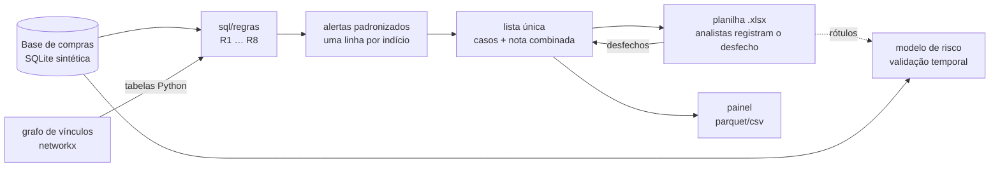

# Procurement Risk Analytics

Auditoria contínua do ciclo de compras de uma empresa — **cotação → pedido → contrato → pagamento** —
com três camadas que se alimentam:

1. **Regras de auditoria em SQL** (fracionamento, fornecedor bloqueado, concorrentes vinculados por grafo,
   conflito de interesse, pagamento duplicado, pago acima do contrato...), todas na mesma saída padronizada de alertas;
2. **Lista única de casos**: os alertas de todas as regras viram casos priorizados por uma nota combinada,
   numa planilha onde os analistas registram o desfecho — que volta para o sistema e mede a taxa de acerto de cada regra;
3. **Modelo de risco de fornecedor** com validação temporal: quais fornecedores ativos serão bloqueados nos próximos 12 meses?

O projeto roda de ponta a ponta sobre uma **base sintética** (SQLite) de uma empresa fictícia, gerada pelo
próprio código com anomalias plantadas — os testes conferem que cada regra encontra todas elas.



## Demonstração rápida

```bash
python -m venv .venv
.venv\Scripts\activate                 # Windows  (source .venv/bin/activate no Linux/macOS)
pip install -r requirements.txt
set PYTHONPATH=src                     # export PYTHONPATH=src no Linux/macOS
python -m risco_compras.demo --recriar
```

Saída (semente padrão):

```
Anomalias plantadas encontradas por regra:
regra  plantadas  encontradas  alertas
   R1          8            8      146
   R2          6            6        6
   R3          6            6        6
   R4          5            5       15
   R5          5            5        5
   R6          6            6        6
   R7          5            5        5
   R8          5            5        5

194 alertas de 8 regras (+6 espelhados dos pares da R3) -> 157 casos ...

| Ranking                              | Average precision | ROC-AUC | Lift@10 |
| Regressão logística                  | 0.17              | 0.94    | 13.9    |
| Linha de base: maior valor comprado  | 0.02              | 0.59    | 0.0     |
```

A R1 gera bem mais alertas do que as anomalias plantadas: são os fornecedores com perfil de risco da base
(compras diretas logo abaixo do limite), que a regra pega "de verdade" — e que o modelo também aprende a ranquear.

## As regras

| ID | Regra | Como funciona |
| --- | --- | --- |
| R1 | Fracionamento de compra direta | Compras diretas do mesmo fornecedor, departamento e categoria no mês, cada uma abaixo do limite de cotação e somadas acima dele |
| R2 | Pedido a fornecedor bloqueado | Pedido emitido durante o período de bloqueio |
| R3 | Concorrentes vinculados | Empresas da mesma cotação ligadas no grafo (sócio, e-mail, telefone ou endereço em comum), com peso por tipo de vínculo |
| R4 | Conflito de interesse | Funcionário ligado a fornecedor (sócio direto ou via empresa relacionada); nota cheia se o pedido é do departamento dele |
| R5 | Pago acima do contrato | Pagamentos dos pedidos do contrato acima do valor contratado + tolerância |
| R6 | Pagamento em duplicidade | Mesmo valor e mesma nota fiscal (ou pedido) pagos de novo dentro de uma janela |
| R7 | Pedido fora da vigência | Pedido vinculado a contrato antes do início ou depois do fim |
| R8 | Empresa de fachada | Primeiro pedido logo após a abertura e/ou capital social incompatível com o volume vendido |

Parâmetros (limites, tolerâncias, janelas) ficam em `config/regras.yaml`; o roteiro de análise de cada regra
(o que verificar, falsos positivos comuns) em `config/roteiro_analise.yaml`.

## Destaques técnicos

- **Contrato único de saída**: toda regra devolve as mesmas colunas (`COLUNAS_ALERTA`), validadas e normalizadas
  em Python — dá para empilhar, priorizar e medir tudo do mesmo jeito.
- **SQL + Python sem gravar no banco**: marcadores `{{csv:...}}` (listas mantidas pela equipe) e `{{dados:...}}`
  (tabelas calculadas em Python, como os pares do grafo) viram tabelas derivadas `VALUES` dentro da consulta.
- **Grafo de vínculos** (networkx) com peso por tipo de aresta; o peso do caminho é o produto dos pesos.
- **Nota combinada** `1 − ∏(1 − nota)`: cada regra é um indício independente; mais regras, maior a prioridade.
- **Ciclo de retorno**: planilha com listas de validação e fórmulas (taxa de acerto por regra), registro
  idempotente dos desfechos com histórico, e a próxima lista já vem preenchida.
- **Modelo sem vazamento**: variáveis só do passado (24 meses antes do corte), rótulo na janela futura,
  exclusão de quem já estava bloqueado, treino nos cortes antigos e teste no último; métricas para classes raras
  (average precision, precisão@k, lift) sempre contra uma linha de base ingênua.
- **Testes de ponta a ponta** sobre a base sintética: cada regra precisa achar 100% das anomalias plantadas, e as
  regras de alta precisão não podem gerar nenhum alerta além delas.

## Estrutura

```
procurement-risk-analytics/
├── config/
│   ├── regras.yaml                 # regras, parâmetros e critérios do lote sugerido
│   ├── roteiro_analise.yaml        # o que verificar em cada regra (aba Roteiro)
│   ├── pesos_vinculos.csv          # peso de cada tipo de vínculo no grafo
│   └── categorias_recorrentes.csv  # categorias que a R1 não analisa
├── sql/regras/                     # uma consulta por regra, na saída padrão de alertas
├── src/risco_compras/
│   ├── dados_sinteticos.py         # base fictícia com anomalias plantadas
│   ├── regras/                     # motor das regras (base.py), etapas Python (preparar.py) e CLI
│   ├── grafos/vinculos.py          # grafo de vínculos
│   ├── resultados/lista_unica.py   # casos, planilha, painel e registro de desfechos
│   ├── modelos/risco_fornecedor.py # base por corte, modelo e avaliação temporal
│   ├── utils/documentos.py         # CPF/CNPJ: normalização, validação, pseudonimização
│   └── demo.py                     # ponta a ponta
├── tests/
└── dados/                          # gerado localmente, fora do git
```

## Comandos

```bash
python -m risco_compras.dados_sinteticos               # gera dados/exemplo.db
python -m risco_compras.regras.executar --todas        # executa as regras
python -m risco_compras.regras.executar --regra R3 --mostrar-sql
python -m risco_compras.resultados.lista_unica         # monta a lista única (planilha + painel)
python -m risco_compras.resultados.lista_unica --registrar   # registra os desfechos preenchidos
python -m risco_compras.modelos.risco_fornecedor       # avalia o modelo de risco
python -m pytest                                       # testes
```

## Dados

Todos os dados são fictícios e gerados pelo código: empresas, pessoas, CPFs e CNPJs aleatórios (apenas com
dígitos verificadores válidos), telefones com DDD 00 e e-mails no domínio `.example`. A pasta `dados/` fica
fora do versionamento por convenção — num uso real, ela teria dados pessoais.

## Licença

[MIT](LICENSE)
